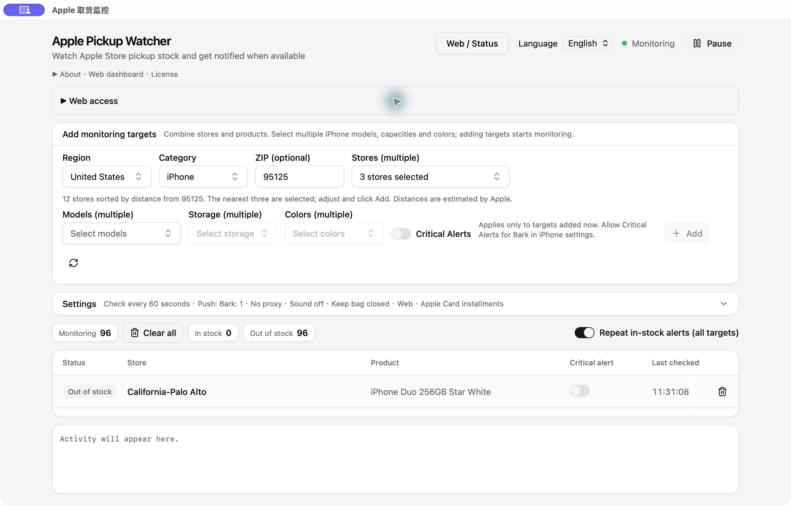

# Apple Pickup Watcher · Apple 取货监控

> **🌐 [Apple Pickup Live · Nationwide stock lookup (US only)](https://pickup.o1xhack.com/)**
>
> An independently operated website we built by adapting this project. Browse saved iPhone Duo pickup availability across the United States by ZIP code, with history and statistics—no app installation required. The website is US-only; the desktop app supports multiple countries and regions. [Website source](https://github.com/o1xhack/apple-pickup-live).

Apple Store pickup stock alerts with a desktop app and a bilingual mobile web dashboard.

[中文](README.md) · [Download](https://github.com/o1xhack/apple-pickup-watcher/releases/latest) · [Attribution](NOTICE)




Download the notarized macOS DMG from Releases, open it and drag the app to Applications. A ZIP and optional installer script are also provided. Select your region, ZIP, stores and configurations, then add targets. Enter your own Bark URL in the desktop settings for iPhone alerts. Critical alerts require permission in Bark; normal notifications are the default.

Open the desktop app's “网页 / Status” button or http://127.0.0.1:17842 for monitoring, history, statistics, English/Chinese and screenshot mode. The language choice is shared between desktop and web, persists across restarts, and applies to future Bark notifications. It does not change the stock-query region, targets or alert level. The app must remain running. For local-network access, enable “Allow local network access” in the desktop Web access panel, then copy the generated link to a trusted device on the same Wi-Fi or wired LAN. The link includes an access token; no manual pairing code is needed. LAN API calls require the token, and public-source connections are rejected. Existing Tailscale Serve access continues unchanged. The app never configures public port forwarding or Tailscale.

Default alerts are deduplicated per continuous in-stock period. An optional global switch repeats alerts on every fresh positive observation. SQLite keeps history across restarts. Failed checks remain unknown, never out of stock. Apple may throttle or block requests; automatic cooldown is not a guarantee against blocking. This is a notification tool, not an automatic checkout or cart bot.

This first fork release includes a locally validated Apple Silicon macOS build. Intel and other Tauri platforms require their own build validation. The official macOS download is Developer ID signed, notarized by Apple and stapled. macOS may still ask for the normal first-open download confirmation. Verify the SHA256 before opening. Self-built and routine CI artifacts are not automatically notarized.

Build with the Rust version specified in Cargo.toml, Node.js LTS, pnpm 9 and [Tauri prerequisites](https://v2.tauri.app/start/prerequisites/):

```sh
pnpm install --frozen-lockfile
pnpm tauri build
```

Fork of [ENCHIGO/apple-pickup-watcher](https://github.com/ENCHIGO/apple-pickup-watcher), originally derived from [Hteen/apple-store-helper](https://github.com/hteen/apple-store-helper). GPL-3.0-or-later; upstream copyrights are preserved. See LICENSE and NOTICE for attribution, dated modifications, redistribution terms and the no-warranty notice. Source and build instructions accompany binary releases. Not affiliated with Apple.


## European stores

Europe is supported in the desktop app, its local web controls and CLI: United
Kingdom, France, Germany, Italy, Spain, Netherlands, Sweden, Switzerland, Belgium,
Austria and Türkiye. Select the country rather than a generic Europe region:
store IDs, Apple storefront, language headers, postal codes and product part
numbers belong to that country. Existing monitoring targets are preserved.
The offline snapshots include standard configurations across all product families;
use the catalog refresh for current and additional Mac upgrade configurations.

Rebuild the new snapshots from Apple's public pages (no stock polling):

```sh
python3 crates/apw-core/data/generate.py --locale en_GB --base-configs-only
```

The public nationwide site is a separate US-only project. This change does not
start European scanning there. Catalog availability never implies stock.
