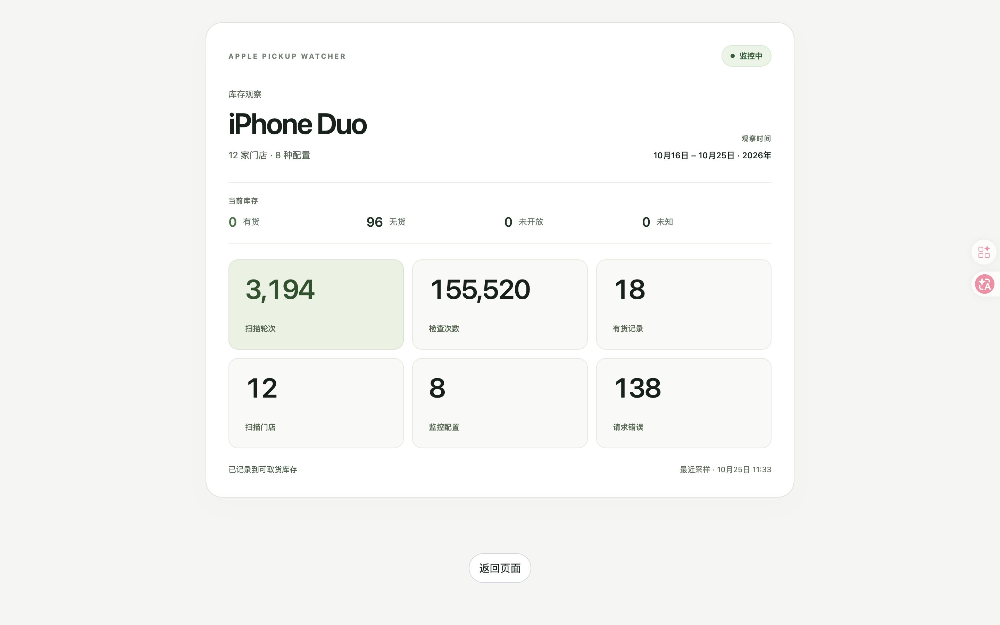
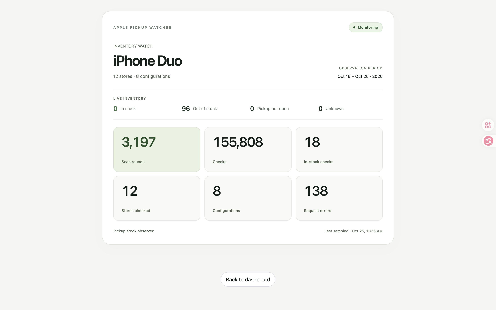
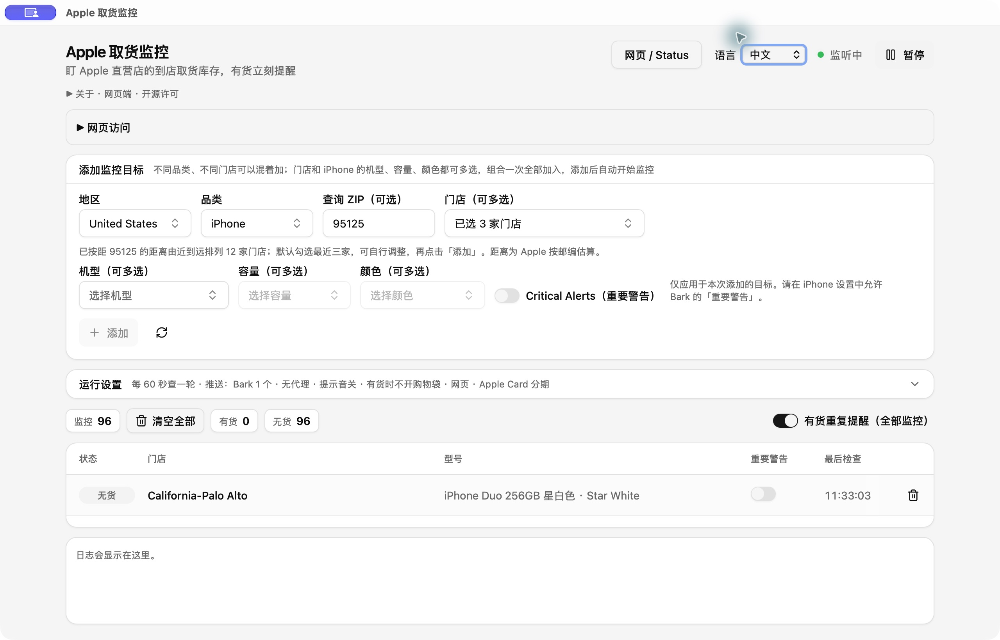

# Apple 取货监控 · Apple Pickup Watcher

Apple 直营店取货库存监控。选门店、选配置，有货通知；App 和手机网页查看同一份数据。

[English](README.en.md) · [下载安装](https://github.com/o1xhack/apple-pickup-watcher/releases/latest) · [来源与许可](NOTICE)



## 安装使用

1. 在 Releases 下载 `.dmg` 安装包。当前首发包适用于 Apple Silicon（M 系列）；Intel 需要自行构建。
2. 打开 DMG，把 App 拖到「Applications / 应用程序」即可使用。也提供 ZIP 与可选安装脚本。
从旧版迁移时请先退出旧版 App；用户配置目录保持兼容，不要同时运行两个版本。

3. 选择地区、输入 ZIP、查找附近门店，选择机型／容量／颜色，点击「添加并开始监控」。
4. 想推送到 iPhone：在运行设置里粘贴你自己的 Bark 推送地址。普通通知默认即可；重要警告须在 iPhone 给 Bark 授权。

官方 v0.6.3 安装包已使用 Developer ID 签名、通过 Apple 公证并附加公证票据；首次打开仍可能出现 macOS 正常的下载来源确认。可用 Releases 的 SHA256 校验文件核对下载。自行构建或 CI 普通构建不自动获得公证。

## App + 网页

点击 App 右上角「网页 / Status」，或在同一台电脑打开 **http://127.0.0.1:17842**。
App 与网页共用中文／英文选择，改动后自动同步并保存，重启仍保留；之后的 Bark 通知跟随所选语言。库存地区、监控目标和提醒级别不随语言变化，已发送的通知保留原文。网页可以添加、编辑监控，查看状态、扫描历史及统计，统计页面有截图模式。

手机访问需要电脑保持运行。在 App 的「网页访问」里开启「允许局域网访问」，会自动显示实际内网 IP；点「复制链接」，同一 Wi-Fi／有线局域网的设备即可查看和编辑，不需要手动输入配对码。链接自带访问凭证，只分享给可信的人。关闭开关即停止局域网访问。若 macOS 询问是否接收传入连接，使用局域网功能时选择允许即可，无需关闭防火墙。

默认只允许本机访问；局域网 API 需开启共享并携带凭证，外网来源不会放行。不会自动配置路由器、公网映射或 Tailscale。已有 Tailscale Serve 私有入口继续可用，仍按 tailnet 身份控制，不增加配对码。




## 通知与记录

- 每个目标可选普通或重要通知。默认同一段持续有货只通知一次；打开「有货重复提醒（全部监控）」后，每次新的有货采样都提醒。
- Bark 分组固定为「Apple 库存监控」，不随语言切换；通知文案跟随语言，普通／重要级别按各目标设置，重要提醒使用 anticipate 铃声。
- SQLite 自动保存扫描与通知记录，重启不会丢失。扫描次数不等于手机数量，有货记录也不等于补货次数。
- 查询失败显示未知，HTTP 541 等拦截会自动冷却重试。更短间隔不保证更及时，浏览器查询也不能保证不被拦截。
- 只提供提醒和商品链接，不代下单，不自动加购物袋。

个人设置和历史保存在系统用户数据目录的 `apple-pickup-watcher` 中。**安装包与源码不含你的 Bark 地址、代理、账号、监控清单或数据库。**

## 从源码构建

需要 Rust（最低版本见 Cargo.toml）、Node.js LTS、pnpm 9，以及 [Tauri 系统依赖](https://v2.tauri.app/start/prerequisites/)。

```sh
pnpm install --frozen-lockfile
pnpm tauri build
```

macOS 产物位于 `target/release/bundle/`；App 内已嵌入网页资源，不依赖开发服务器。Windows/Linux 保留 Tauri 构建路径，但本分叉首次发布只提供本机已验证的 macOS Apple Silicon 包；其他平台以构建验证结果为准。安装时把 App 放进应用程序再启动。

## 来源与开源许可

本项目基于 [ENCHIGO/apple-pickup-watcher](https://github.com/ENCHIGO/apple-pickup-watcher)，该项目继承自 [Hteen/apple-store-helper](https://github.com/hteen/apple-store-helper)。

本分叉新增美国 ZIP/门店查询、SQLite 历史与统计、移动网页、中英文网页、逐目标重要提醒、全局重复提醒、浏览器查询及冷却恢复，并修复安装与关窗恢复问题。修改日期与版权详见 [NOTICE](NOTICE)。整体继续以 **GPL-3.0-or-later** 发布，保留上游版权与许可；分发二进制同时提供对应完整源码和构建方式。本项目与 Apple 无关联，不提供库存或抢购成功保证。


## 欧洲门店

桌面 App、本机网页和 CLI 支持英国、法国、德国、意大利、西班牙、荷兰、瑞典、瑞士、比利时、奥地利及土耳其。请按国家选择地区；各国分别使用真实门店、邮编、Apple 商店入口、语言请求头和商品零件号，不复用美国 SKU。已有监控配置保留。

离线目录包含各产品系列的基础配置；最新型号及更多 Mac 升级配置可通过刷新目录取得。可用 `python3 crates/apw-core/data/generate.py --locale en_GB --base-configs-only` 重建基础快照。独立的全国库存网站仍只采集美国；本次不为网站新增欧洲扫描。目录存在不代表有货，失败依然显示 Unknown。
